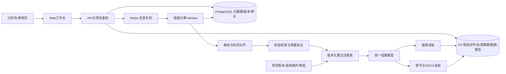

# 风资源自动化分析平台 · 架构文档 V0.1

## 1. 架构决策

建议采用模块化单体API加独立计算Worker，避免初期微服务运维负担。前端建议React + TypeScript，后端FastAPI/Python，科学计算采用pandas/NumPy/SciPy，图形采用Matplotlib，元数据PostgreSQL，对象MinIO或云S3，任务队列Celery/Redis，报告采用docxtpl/python-docx并按需接入隔离的LibreOffice转换。上述为生产技术建议，本次原型采用原生HTML/CSS/JS和Python静态服务器，未安装或实现这些生产服务。

## 2. 组件与数据流



模块划分：项目与权限、资产导入、通道映射、版本与谱系、QC、统计与相关性、工程算法、图表、报告、规范、审计。模块只通过服务接口和稳定结果模型交互。客户端不携带对象存储长期密钥；Worker不直接接受任意Python或模板代码。

## 3. 数据模型

|实体|关键字段/约束|
|---|---|
|Project/Site/Mast/Channel|project_id、场区、坐标CRS、塔高、海拔、测量高度、传感器、单位、时区；所有查询按项目鉴权|
|Asset|id、project_id、object_key、sha256、bytes、MIME、created_by、retention；对象不以用户文件名作为路径|
|DatasetVersion|id、asset_id、stage(raw/qc/final/mesoscale)、parent_ids、mapping_version、time_range、time_step、timezone、source_height、status；冻结后不可变|
|Observation（Parquet）|timestamp_utc、channel_id、speed、direction、stddev、temperature、pressure、qc_flags、source_row；保留原始值与单位映射|
|AnalysisConfig|dataset_ids、reference_id、period、window_anchor/mode、window_years、hub_height、sector_count、calm_threshold、density_mode、bin_edges、standard_versions|
|AnalysisRun|config_hash、input_hashes、algorithm_versions、environment_digest、seed、status、started/ended、error；相同输入允许复用通过验证的产物|
|Result/Chart|run_id、metric_key、dimensions、unit、sample_count、denominator、assumptions、warnings、payload/asset_id；表图共源|
|StandardVersion|编号年号、适用域、来源附件、公式/测试集、审核人、状态draft/approved/retired|
|TemplateVersion/ChapterBlock|语义ID、占位符Schema、循环维度、必填项、样式版本、图表绑定；发布版本不可覆盖|
|ReportRevision/ReviewItem|run_id、template_version、draft_asset、first_draft标志、parent_id、reviewer、黄色字段、状态；初版唯一约束|
|AuditEvent|actor、project、动作、对象ID、前后版本、时间、请求ID；禁写原始密钥和资料全文|

二进制文件不直接塞入数据库。用户所称“云端数据库留存”实现为对象存储保存原件与报告，关系库保存可检索索引、状态、谱系及权限。标准化序列使用Parquet便于大文件按通道和年份扫描。

## 4. API契约草案

统一 /api/v1，身份由服务端会话或OIDC获取；不得信任客户端project_id就跳过归属校验。错误结构为{code,message,field_errors,request_id}，列表分页；所有上传完成和任务创建接口带幂等键。

|方法/路径|用途|
|---|---|
|POST /projects；GET /projects/{id}|项目创建与详情|
|POST /projects/{id}/assets/uploads|校验类型大小，返回短期上传URL|
|POST /assets/{id}/complete|校验对象存在、大小与哈希后注册，不采信客户端完成标志|
|POST /datasets/preview|限定行数解析，返回候选字段与错误，不执行Excel公式|
|POST /datasets；POST /datasets/{id}/freeze|保存映射/阶段/来源，预检通过后冻结|
|POST /analysis-runs|冻结配置并返回202 {run_id,status}|
|GET /analysis-runs/{id}；POST /analysis-runs/{id}/cancel|进度、分阶段日志及取消|
|GET /analysis-runs/{id}/results|获取统一数值/统计/告警，不重复在前端计算生产指标|
|POST /reports；GET /reports/{id}/review-items|生成草稿与人工项|
|POST /reports/{id}/revisions；POST /reports/{id}/approve|修订及独立审核，保留初版|
|GET /assets/{id}/download|项目鉴权后返回短期签名URL|
|GET /standards；POST /standards/{id}/approve|规范版本及工程审核|

示例AnalysisConfig：
```json
{"dataset_ids":["ds-final-v1"],"reference_id":"ds-meso-v1","period":{"start":"2024-01-01T00:00:00+08:00","end":"2025-01-01T00:00:00+08:00"},"window_anchor":"2025-01-01","window_mode":"trailing_calendar_years","window_years":20,"hub_height_m":125,"sector_count":16,"density_mode":"measured","standard_versions":[]}
```
未指定已批准规范时，生产API拒绝工程判级任务，而允许不依赖规范的基础统计任务。

## 5. 任务状态与一致性

上传状态：received→quarantined→parsed→mapped→validated→frozen；失败保留错误清单。计算状态：queued→running→succeeded/failed/cancelled；规范/数据不足返回blocked并提供缺项。

Worker任务分为解析、QC、统计、相关、工程指标、图表、报告。记录阶段进度而非伪造百分比。任务超时、内存上限、重试次数可配置；确定性输入错误不自动重试；临时存储失败可退避重试。以输入哈希+配置哈希+算法版本组成幂等键；对象先写临时键，校验后提交元数据事务，以outbox发布下游事件。失败不留下可下载的“成功”报告。

报告冻结run和模板版本，不引用正在变化的最新数据。表/图/文字引用相同metric_key。初版生成通过唯一约束防并发重复，后续只新增修订；规范更新不会静默改写历史报告。

## 6. 扩展机制

算法插件声明id、version、input_schema、output_schema、适用条件、所需规范、单位和compute入口；注册表白名单加载。density、shear、turbulence、extreme、mcp分别独立。模板插件声明章块、循环维度、图表键与人工字段；页面以路由和组件注册扩展；布局令牌集中配置。版本升级提供Schema迁移，老报告保留旧结果，不强迫重算。

极端风速插件默认未启用；标准附件上传只创建draft，审核并通过基准测试后才approved，不能直接执行附件里的文字或宏。对未授权规范全文不默认跨项目共享。

## 7. 部署、容量与安全

开发：前端、API、Worker、Postgres、Redis、S3兼容存储通过Compose编排；生产：反向代理TLS、私有数据库与队列、受限Worker网络、对象存储加密。无需初期Kubernetes。规范和上传资料仅按权限提供，不通过公开静态目录暴露。

容量基线待样本验证：10分钟数据约52,560行/塔/非闰年/通道组；30年小时序列约263,000行，必须按实际通道与闰年估算，不能视为压测结果。批量读取、Parquet分区、有限Worker并发，避免一次加载全部项目。设置可配置文件大小、解压比、解析时长和任务内存限额；不支持的格式返回明确错误。

项目级RBAC覆盖上传、读取、计算、下载、审批；审核职责分离。审计记录短期下载授权，CSV导出需防公式注入。备份数据库与对象版本，进行恢复一致性校验；保留期、恢复点和恢复时间目标由用户确认。监控队列积压、失败率、执行耗时、存储容量、恢复结果；日志关联request_id/run_id，不打印敏感数据。

## 8. 验证计划与就绪门槛

真实计算引擎上线前必须覆盖：重复/乱序/时区/闰日数据；原始与QC差异；已订正数据不二次订正；频率归一化；mean(v³)；圆周方向；零方差与低样本相关；10/20/30年覆盖不足；Weibull失败；缺σ不得算湍流；无规范不得判级。以手工可核对的小样本加独立工程基准验证，不用漂亮图形代替数值验算。

集成验收：上传四阶段资料→冻结→计算→同run表图→DOCX→标黄复核→初版留存→授权下载→备份恢复。跨项目读写必须拒绝。对任务重试、取消、存储失败和并发生成做故障测试。目标Office中核对目录、分页、题注和高亮。

本次原型验证范围：导航、配置校验、长序列窗口预览、CSV字段映射和统计、XLSX明确不支持提示、图表切换、草稿及CSV/JSON下载；不以此代替以上生产验收。
